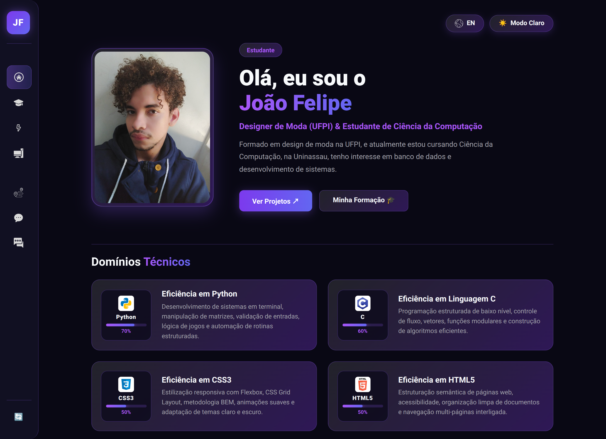
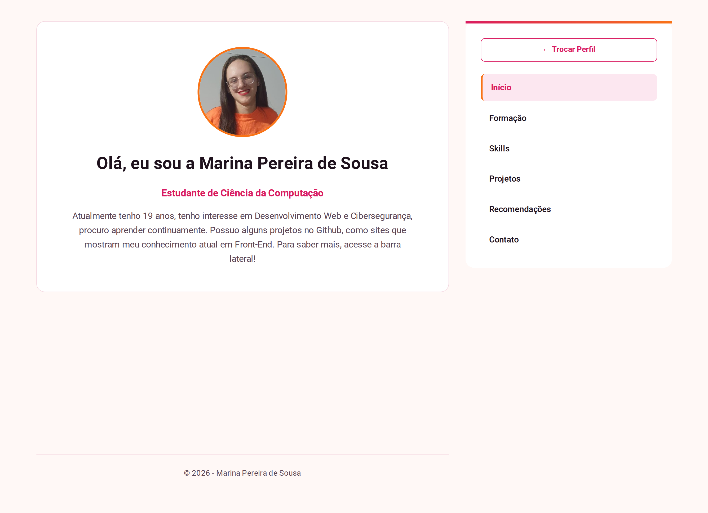
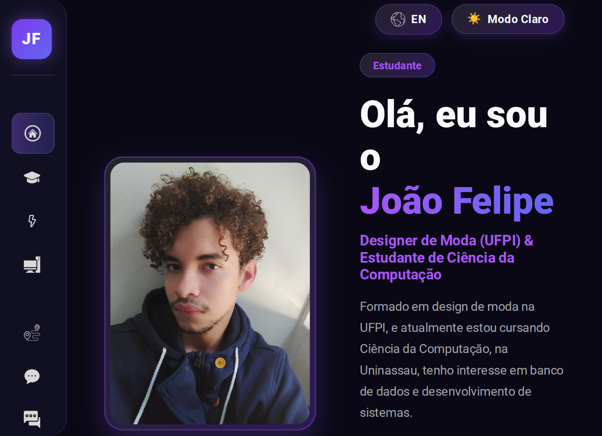
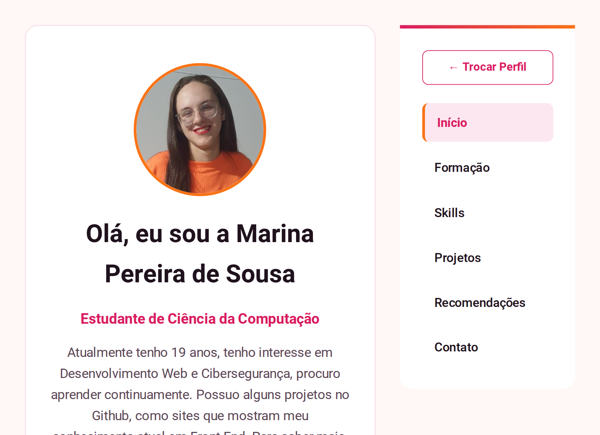
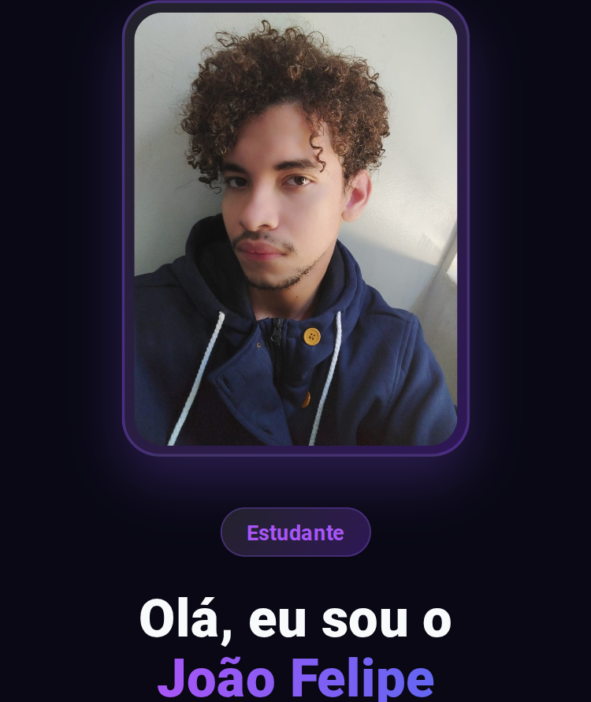

# 🌐 Portfólio Duplo - Projeto Acadêmico

Um site de portfólio colaborativo desenvolvido para apresentar a trajetória, habilidades e projetos de dois estudantes de Ciência da Computação. O projeto conta com uma página inicial de seleção de perfil e navegabilidade dedicada para cada desenvolvedor.

---

## 📌 Sobre o Projeto

A ideia principal do projeto é servir como uma vitrine profissional compartilhada. Ao acessar a aplicação, o usuário encontra uma landing page central onde pode escolher qual portfólio deseja navegar.

### 🗺️ Fluxo de Navegação

1. **Página de Seleção (Início Global):** Apresenta os dois desenvolvedores com fotos e botões de acesso direto ao perfil de cada um.
2. **Portfólio Individual:** Cada perfil conta com uma **barra de navegação lateral (Sidebar)** interativa para alternar entre as seções:
   - **Início:** Apresentação geral e resumo profissional.
   - **Formação:** Informações acadêmicas, cursos e certificações.
   - **Skills:** Tecnologias, linguagens e ferramentas dominadas.
   - **Projetos:** Galeria com os principais trabalhos e repositórios.
   - **Recomendações:** Depoimentos, feedbacks e avaliações.
   - **Contato:** Links para redes sociais, GitHub, LinkedIn e formulário/e-mail.

---

## 🛠️ Tecnologias Utilizadas

- **HTML5:** Estruturação semântica das páginas e da navegação.
- **CSS3:** Estilização responsiva, layout da barra lateral e efeitos visuais.

---

## 📁 Estrutura de Arquivos do Projeto

```text
PORTFOLIO/
├── devFelipe/
│   ├── css/
│   ├── imagens/
│   ├── js/
│   ├── contato.html
│   ├── formacao_jf.html
│   ├── inicio_jf.html
│   ├── projetos.html
│   ├── recomendacoes.html
│   ├── skills.html
│   └── trajetoria.html
├── devMarina/
│   ├── contato.html
│   ├── formacao.html
│   ├── projetos.html
│   ├── recomendacoes.html
│   ├── skills.html
│   ├── sobremim_Marina.html
│   └── style.css
├── imagens/
├── index.html
└── README.md
```

## 📸 Capturas de Tela (Responsividade)

### 🖥️ Desktop (1366px)



### 📱 Tablet (768px)



### 📲 Smartphone (375px)

